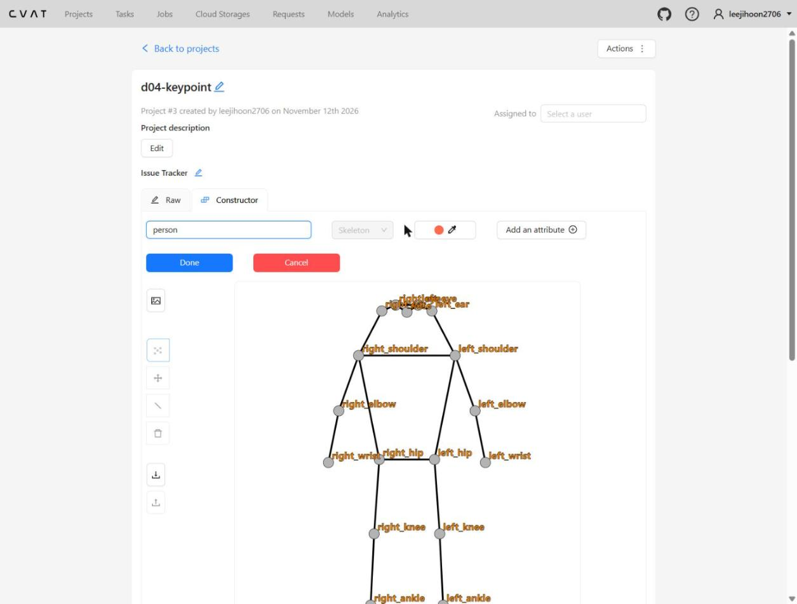
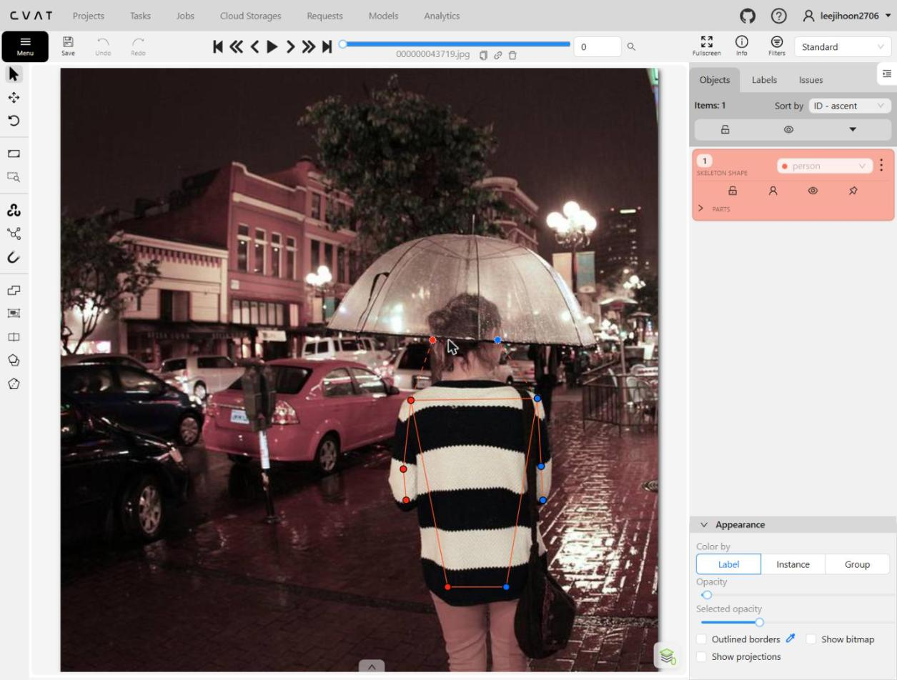
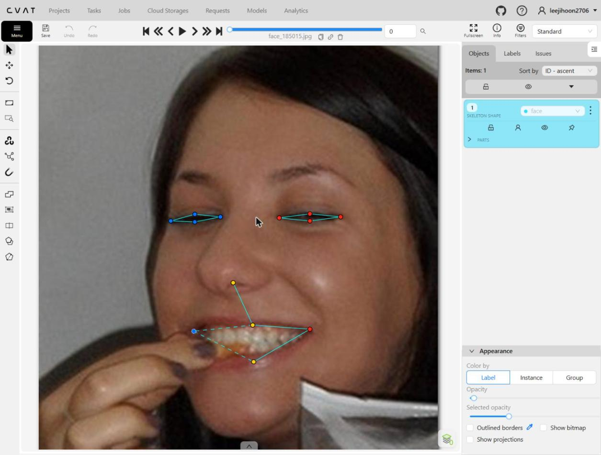
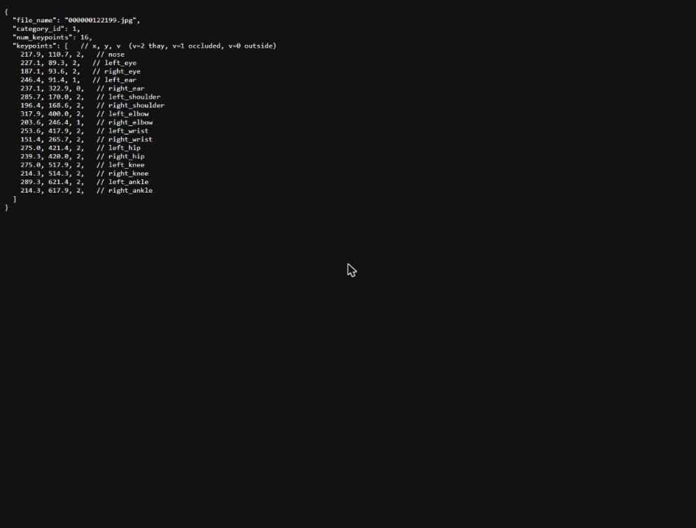

# Báo cáo cá nhân — NguyenHoanThien-2A202603123


Dữ liệu: 12 ảnh người COCO val2017 (Lin et al., 2014) và 8 ảnh chân dung Wikimedia Commons, chỉ dùng trong lớp.

## 0. Thông tin học viên

- Họ tên: Nguyễn Hoàn Thiện
- MSSV: 2A202603123
- Email: 26ai.thiennh@vinuni.edu.vn
- Link repository: https://github.com/leejihoon-quant/K5-L2-DAY04-NguyenHoanThien-2A202603123-KeypointPose
- Phiên bản CVAT (Help → About): 2.74.1
- Máy: Windows 11 Pro · RAM 15,7 GB · chạy CVAT chế độ đầy đủ 
- Bộ ảnh (`src/exports/assignment.json`): có. File ghi đúng cấu trúc của `lab.py setup` (MSSV, bộ ảnh tính từ MSSV, id task và job); task được tạo qua giao diện CVAT trên trình duyệt, không qua lệnh `lab.py setup` (lệnh đó cần nhập mật khẩu).
- Giờ bắt đầu: 4:35pm
- Giờ kết thúc: 7:00pm

## 1. Kiểm tra label (CP0)

| Label | Kiểu | Số điểm | Tên điểm đúng bảng của lab? | Đúng thứ tự? | Số cạnh |
|---|---|---:|---|---|---:|
| `person` | Skeleton | 17 | Có | Có | 19 |
| `face` | Skeleton | 13 | Có | Có | 13 |

Mẫu `person` dựng theo người quay mặt về camera (các điểm `left_*` nằm bên phải khung mẫu)? Có (ảnh chụp 1 cho thấy `left_shoulder`, `left_elbow`, `left_wrist`, `left_hip` nằm bên phải khung mẫu).

Cách đổi cờ `occluded` / `outside` cho **một điểm** trên phiên bản CVAT này (một câu):chọn part, chọn một điểm muốn đổi, rồi nhấn O


## 2. Số lượng đã gán và thời gian (CP1, CP2)

| Nhóm ảnh | Số ảnh | Số skeleton đã gán | Số người dưới 60 px (không gán) | Số poster / gương / màn hình bỏ qua | Thời gian (phút) |
|---|---:|---:|---:|---:|---:|
| `easy` | 5 | 5 | 0 | 0 | [TỰ ĐIỀN] |
| `occluded` | 3 | 6 | 0 | 0 | [TỰ ĐIỀN] |
| `back` | 2 | 3 | ≈ 3 | 0 | [TỰ ĐIỀN] |
| `small` | 1 | 3 | ≈ 7 | 0 | [TỰ ĐIỀN] |
| `crowd` | 1 | 3 | ≈ 5 | 0 | [TỰ ĐIỀN] |
| `faces` | 8 | 8 | — | 0 | [TỰ ĐIỀN] |

(Số skeleton lấy từ file xuất: tổng 20 skeleton người và 8 skeleton mặt; nhóm ảnh theo bộ ảnh trong `assignment.json`. Số người dưới 60 px ở các nhóm `back`, `small`, `crowd` là số ước lượng bằng mắt từ ảnh, chỉ đếm những người nhỏ ở nền, chưa đo chiều cao từng người; các nhóm còn lại không thấy người nhỏ chưa gán.)

Ghi chú để điền bảng trên (từ lúc gán, cần đối chiếu nhóm ảnh trong `assignment.json`):

- Người dưới 60 px không gán: `000000381889.jpg` có 1 người nhỏ ở nền, cao khoảng 24 px, không gán. Ngoài ra ở nền ảnh này và `000000043719.jpg` còn vài người rất nhỏ khác, không gán. Chưa đếm chính xác từng ảnh.
- Poster / gương / màn hình: trong 12 ảnh người và 8 ảnh mặt không thấy poster, gương hay màn hình có hình người nào cần bỏ qua (ảnh `000000179201.jpg` có một TV nhưng không có người trên màn hình).
- Một người không gán dù cao trên 60 px: người phụ đứng dưới ô ở `000000043719.jpg`, bị ô và người phía trước che gần hết nên không xác định được khớp và hướng người (xem mục 3).

- Số ảnh người đã xong ở mốc phút 105: [TỰ ĐIỀN] / 10
- Thời gian thực tế (phút): CP1 [TỰ ĐIỀN] · CP2 [TỰ ĐIỀN] · CP3 [TỰ ĐIỀN]
- Ảnh tốn thời gian nhất là ảnh nào, vì sao? [TỰ ĐIỀN: ảnh thực sự tốn thời gian nhất và lý do; gợi ý ứng viên: `000000269462.jpg` hoặc `000000381889.jpg`]

## 3. Bảng ca khó (CP1, CP2)


Mỗi điểm bạn phân vân một dòng, nhất là phân vân giữa `v = 1` và `v = 0`, hoặc không chắc hướng người.

| Ảnh | Người / mặt | Điểm | Cờ đã chọn | Phân vân giữa | Lý do chọn |
|---|---|---|---:|---|---|
| `000000043719.jpg` | người 1 (quay lưng, cầm ô) | `nose`, 2 mắt | 0 | `v = 0` / `v = 1` | Quay lưng, không thấy mặt; vị trí mũi và mắt trên đầu không chắc nên chọn `v = 0` |
| `000000043719.jpg` | người 1 | 2 tai | 1 | `v = 1` / `v = 0` | Tóc búi che tai nhưng tai nằm hai bên đầu, ước lượng chắc |
| `000000043719.jpg` | người phụ dưới ô | cả người | không gán | gán / không gán | Cao hơn 60 px nhưng bị ô và người phía trước che, không xác định được khớp và hướng người |
| `000000311497.jpg` | người 1 (người đánh tennis, đi nghiêng) | `knee`, `ankle` | 2 | trái / phải | Hai chân chồng lên nhau, không chắc chân nào là chân trái; chọn theo phía của hông trái (xem mục 5) |
| `000000269462.jpg` | 3 kỵ sĩ quay lưng | chân (`knee`, `ankle`) | 0 / 1 / 2 | `v = 1` / `v = 0` | Chân bị thân ngựa che; chỉ giữ `v = 2` ở phần chân thấy rõ, phần còn lại `v = 0` |
| `000000179201.jpg` | 2 người ngồi sau bàn kotatsu | `hip` | 1 | `v = 1` / `v = 0` | Hông bị bàn và chăn che nhưng vị trí ước lượng được từ thân người |
| `face_185015.jpg` | mặt 1 | `mouth_right` | 1 | `v = 1` / `v = 2` | Khóe miệng bị ngón tay che |

## 4. Bảng tự review (CP3)


Đi từ ảnh cuối về ảnh đầu. 5 ảnh người (ít nhất 2 ảnh `back` hoặc `crowd`) và 3 ảnh mặt. Ít nhất 8 dòng, kể cả dòng `ok`. Ghi lỗi trước, sửa sau.

Mã lỗi dùng đúng một trong: `lr_swap`, `vis_flag`, `position`, `missing`, `extra`, `ok`.

Các dòng dưới là những lỗi có thật đã được tìm ra và sửa. Các dòng `ok` và phần còn lại bạn tự bổ sung sau khi tự review; chưa điền để không ghi sai.

| Ảnh | Người / mặt | Điểm | Mã lỗi | Ghi chú | Đã sửa? |
|---|---|---|---|---|---|
| `000000164659.jpg` | người 1 | `left_shoulder` | `position` | Điểm đặt hơi lệch ra ngoài vai khi vẽ lại điểm lên ảnh để kiểm | Có |
| `000000381889.jpg` | người 1 (áo xanh) | `right_shoulder` | `position` | Điểm đặt sát mép ảnh, lệch khỏi vai | Có |
| `000000122199.jpg` | người 2 | `left_shoulder`, `right_shoulder` | `lr_swap` | Người quay mặt về camera nhưng vai trái đặt bên trái ảnh; phát hiện bằng cảnh báo của script ở CP4 | Có |
| `000000311497.jpg` | người 1 | `knee`, `ankle` | `lr_swap` | Cặp gối, mắt cá nằm ngược phía so với hông và vai; phát hiện bằng cảnh báo của script ở CP4 | Có |
| [TỰ ĐIỀN: dòng 5, ảnh người] | | | | | |
| [TỰ ĐIỀN: dòng 6, ảnh người `back`/`crowd`] | | | | | |
| [TỰ ĐIỀN: dòng 7, ảnh mặt] | | | | | |
| [TỰ ĐIỀN: dòng 8, ảnh mặt; cần đủ 3 ảnh mặt] | | | | | |

Tổng hợp số lỗi theo mã:

| `lr_swap` | `vis_flag` | `position` | `missing` | `extra` | `ok` |
|---:|---:|---:|---:|---:|---:|
| [TỰ ĐIỀN: đếm sau khi bảng trên đủ dòng] | | | | | |

Điểm còn phân vân giữa `v = 1` và `v = 0` (ghi cả hai lựa chọn và lý do chọn):

- Mũi, mắt người quay lưng (`000000043719.jpg`): chọn `v = 0`; `v = 1` cũng hợp lý vì vị trí chiếu lên đầu ước lượng được, nhưng độ chắc thấp.
- Hai tai người quay lưng (`000000043719.jpg`): chọn `v = 1`; `v = 0` cũng có thể vì tóc che hoàn toàn.
- Hông của hai người ngồi sau bàn (`000000179201.jpg`): chọn `v = 1`; `v = 0` cũng có thể vì bị che hoàn toàn.

## 5. Kiểm file xuất và kết quả tự kiểm (CP4)

Tự kiểm trong file JSON (`annotations/person_keypoints_default.json` trong zip):

| File | Người / mặt kiểm (ảnh, thứ tự) | Số phần tử `keypoints` | Điểm `outside` ra `v = 0`, `occluded` ra `v = 1`? | `num_keypoints` khớp? |
|---|---|---:|---|---|
| `NguyenHoanThien_persons.zip` | `000000043719.jpg`, người 1 (quay lưng) | 51 | Có: mũi, 2 mắt, 2 gối, 2 cổ chân `v = 0`; 2 tai `v = 1` | Có (10 = 8 điểm `v = 2` + 2 điểm `v = 1`) |
| `NguyenHoanThien_persons.zip` | `000000122199.jpg`, annotation id 2 | 51 | Có: `right_ear` `v = 0`; `left_ear`, `right_elbow` `v = 1` | Có (16 = 14 + 2) |
| `NguyenHoanThien_faces.zip` | `face_185015.jpg`, mặt 1 | 39 | Có: `mouth_right` `v = 1` (bị ngón tay che); không có điểm `v = 0` | Có (13 = 12 + 1) |

Sau khi xuất, CVAT ghi `occluded` thành `v = 1` và `outside` thành `v = 0`. Tọa độ của điểm `outside` trong file là tọa độ cũ (ví dụ nose của người quay lưng ra `436.4, 414.1, 0`), không phải `0, 0`.

Hai job đã chuyển sang completed trên CVAT? Có (job 12 `persons`, job 13 `faces`).

Dán phần **TÓM TẮT** in ra từ `src/check_submission.py`:

```text
- File person: NguyenHoanThien_persons.zip
  Số ảnh: 12 · số skeleton `person`: 20 · mỗi annotation 51 số
  Skeleton theo ảnh: 000000043719=1, 000000122199=2, 000000164659=1, 000000177889=1, 000000179201=2, 000000269462=3, 000000311300=2, 000000311497=2, 000000343057=1, 000000381889=3, 000000463932=1, 000000493741=1
  Cờ v: v=2 223 (66%) · v=1 49 (14%) · v=0 68 (20%)
  num_keypoints trung bình: 13.6
- File face: NguyenHoanThien_faces.zip
  Số ảnh: 8 · số skeleton `face`: 8 · mỗi annotation 39 số
  Skeleton theo ảnh: face_185015=1, face_249336=1, face_256814=1, face_3348=1, face_415073=1, face_496353=1, face_560282=1, face_575921=1
  Cờ v: v=2 92 (88%) · v=1 12 (12%) · v=0 0 (0%)
  num_keypoints trung bình: 13.0
- Ghi chú: 68 điểm v = 0 vẫn mang tọa độ cũ (CVAT 2.x xuất như vậy; chuẩn COCO ghi 0, 0). Không phải lỗi: điểm v = 0 bị bỏ qua khi huấn luyện và khi chấm.
- Số [LỖI]: 0 · số [CẢNH BÁO]: 0
Kết quả: ĐẠT
```

Khối trên là kết quả lần chạy cuối, sau khi sửa và export lại. Lần chạy đầu (trước khi sửa) script báo 2 `[CẢNH BÁO]`, được xử lý như sau:

- `000000122199.jpg #2`: cặp `shoulder` nằm ngược phía so với các cặp còn lại. Sau khi mở ảnh, đây là lỗi `lr_swap` thật và đã sửa: người này đứng quay mặt về camera nên vai trái phải nằm bên phải ảnh, nhưng lúc gán mình đặt `left_shoulder` ở bên trái ảnh. Đã đổi chỗ hai vai.
- `000000311497.jpg #1`: cặp `knee`, `ankle` nằm ngược phía. Người đánh tennis đi nghiêng, hai chân chồng lên nhau nên không chắc chân nào là chân trái thật; đã đổi chỗ để cùng phía với hông trái và vai trái, khớp với các cặp còn lại. Coi là `lr_swap` đã sửa.

## 6. Ảnh chụp màn hình

1. Label `person` trong label constructor (đủ 17 điểm có tên):

   

2. Một người quay lưng đã gán, cờ đã đặt:

   

3. Một khuôn mặt đã gán 13 điểm, phóng to vùng mắt:

   

4. Một đoạn JSON xuất của một người:

   

Nguồn ảnh: COCO val2017 / Wikimedia Commons.

## 7. Tự đánh giá


1. Lỗi bạn mắc nhiều nhất hôm nay, và cách bạn sẽ tránh ở dự án thật:

   Bị nhầm left-right giữa người ,chưa biết xác định người nhỏ có nên cho vào annotation hay không. 
   Rút kinh nghiệm: Hỏi lại labcoach/mentor về tiêu chuẩn của việc trước khi bắt đau 

2. Một quy tắc bạn đề xuất thêm vào guideline (kèm ảnh ví dụ nếu có):

   Không có
3. Nhãn của bạn đi vào model ở đâu? Chọn một lỗi bạn đã sửa và nói nó sẽ làm model học sai thế nào (heatmap, trọng số trong loss, hay bước lật ảnh):

  Một lỗi mình mắc là gắn v = 2 cho điểm thực ra bị che, ví dụ cổ tay bị tay áo che hoàn toàn. Nhãn này đi vào model qua bước tạo heatmap mục tiêu: điểm có v > 0 được vẽ thành một Gaussian tại tọa độ mình đặt. Vì cờ là v = 2, điểm này tính đầy đủ vào loss, nên model bị phạt khi không dự đoán đúng vị trí mà mình ước lượng. Nhưng trên ảnh không có chi tiết nào để model dựa vào, nên nó chỉ có thể học đoán mò. Hậu quả là heatmap của cổ tay bị mờ và độ tin cậy giảm ở những ảnh có tay áo che. Nếu mình gắn đúng v = 1, điểm vẫn được học nhưng đúng là một điểm ước lượng; nếu v = 0, nó bị mask khỏi loss và không làm nhiễu model.

## 8. Khó khăn và lỗi kỹ thuật

- Task `persons` và `faces` được dựng qua giao diện CVAT trên trình duyệt, không qua `lab.py setup` (lệnh đó cần nhập mật khẩu).
- Khó khăn khi gán: ảnh người quay lưng hoặc bị che (khó quyết định `v = 1` hay `v = 0`), người đi nghiêng có hai chân chồng nhau (dễ đặt ngược trái/phải), và ảnh nhiều người chồng nhau.
- Lỗi kỹ thuật: khi chuyển trang job nhiều lần liên tiếp, trang CVAT báo "Connecting..." khá lâu; nếu chuyển trang khi đang làm dở, dữ liệu chưa lưu có thể mất, nên cần lưu sau mỗi người.

## Bonus (nếu làm)

Hai job bonus `persons-extra` (task 16, job 14) và `faces-extra` (task 17, job 15) đã gán xong và đã completed trên CVAT. Hai file xuất (COCO Keypoints 1.0, không kèm ảnh) là `src/exports/NguyenHoanThien_bonus_persons.zip` và `src/exports/NguyenHoanThien_bonus_faces.zip`, xuất sau lần sửa cuối.

| Job | Ảnh | Số skeleton đã gán |
|---|---|---:|
| `persons-extra` (job 14) | `000000065350.jpg` | 2 |
| `persons-extra` (job 14) | `000000196853.jpg` | 2 |
| `persons-extra` (job 14) | `000000213506.jpg` | 3 |
| `faces-extra` (job 15) | `face_102517`, `face_296417`, `face_379585`, `face_45276`, `face_507166` | 5 (mỗi ảnh 1) |

Tổng: 7 skeleton người (sau khi xóa 1 skeleton thừa, xem dưới) và 5 skeleton mặt.

Kết quả `src/check_submission.py` cho `NguyenHoanThien_bonus_persons.zip` (lần chạy cuối):

```text
- File person: NguyenHoanThien_bonus_persons.zip
  Số ảnh: 3 · số skeleton `person`: 7 · mỗi annotation 51 số
  Skeleton theo ảnh: 000000065350=2, 000000196853=2, 000000213506=3
  Cờ v: v=2 70 (59%) · v=1 12 (10%) · v=0 37 (31%)
- Số [LỖI]: 0 · số [CẢNH BÁO]: 0
Kết quả: ĐẠT
```

Kết quả `src/check_submission.py` cho `NguyenHoanThien_bonus_faces.zip` (lần chạy cuối):

```text
- File face: NguyenHoanThien_bonus_faces.zip
  Số ảnh: 5 · số skeleton `face`: 5 · mỗi annotation 39 số
  Skeleton theo ảnh: face_102517=1, face_296417=1, face_379585=1, face_45276=1, face_507166=1
  Cờ v: v=2 62 (95%) · v=1 3 (5%) · v=0 0 (0%)
- Số [LỖI]: 0 · số [CẢNH BÁO]: 0
Kết quả: ĐẠT
```

B2 — nhận xét về ảnh không màu: [TỰ ĐIỀN: ảnh không màu khó hơn ở điểm nào? Kính râm trên ảnh hồng ngoại có còn là `v = 1` không?]

Ca khó và lỗi đã sửa ở bonus:

- `000000196853.jpg` người số 3: script báo cao 18 px, dưới 60 px. Đây là người quay lưng ở nền bên phải, bị người đứng giữa che gần hết, mình chỉ gán được 2 vai. Mã lỗi `extra`, đã xóa skeleton này.
- `000000065350.jpg`: người thứ ba (quần trắng, đi giày trượt) bị người đứng che đầu, không xác định được khớp nên không gán. Người ngã ngửa quay lưng có mũi và mắt `v = 0` (mũ bảo hiểm che), tai `v = 1`.
- `000000213506.jpg`: hai người chồng nhau ở vỉa hè; hông của người áo đen bị người mặc đầm che nên `v = 1`, tay phải của cô ấy `v = 0`. Người ở cửa sổ chỉ thấy đầu và hai cẳng tay, phần dưới bị bệ cửa che nên chỉ gán mắt, mũi, vai và tay.
- `face_102517.jpg` (kính gọng dày, ria mép): khóe miệng và môi trên bị ria che nên `v = 1`.

## 9. Tài liệu tham khảo và công cụ AI đã dùng


-Các tài liệu từ repo đã fork
- Công cụ AI: Claude (Anthropic) hướng dẫn thao tác, chỉ ra các lỗi, giải thích guidline, quy trình nộp bài, chạy script check submission
- Claude cũng được dùng cho các việc kỹ thuật, không dùng để sinh hay sửa điểm keypoint: dựng project và task trên CVAT qua giao diện trình duyệt (không qua `lab.py setup`), ghi `src/exports/assignment.json`, export các file zip, chụp ảnh màn hình 1–3 từ CVAT (ảnh 4 là đoạn JSON thật trích từ file xuất), điền các số liệu trong báo cáo từ file xuất và script (mục 0, 1, 2, 5, Bonus; số người nhỏ ở mục 2 là ước lượng bằng mắt từ ảnh), đổi tên repo và upload file lên GitHub.
